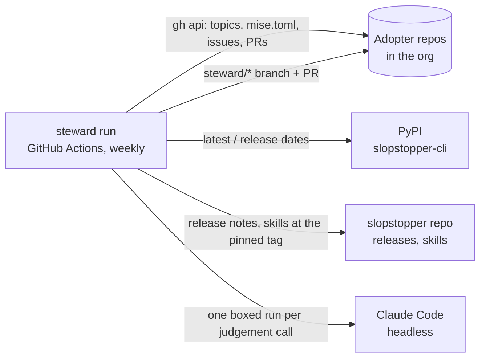
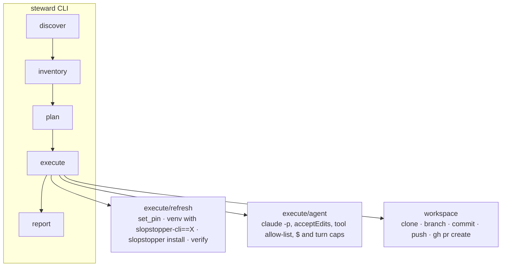

# Architecture

How a steward run works and where it stops. Notation: C4 (Context +
Container).

## Routes

| When you are…                                                          | Do this                                                                                   |
| ---------------------------------------------------------------------- | ----------------------------------------------------------------------------------------- |
| changing what the steward reads from slopstopper, or slopstopper moved a file, marker or flag | Read [CONTRACT.md](CONTRACT.md) for the surface table, the sync test and the upstream change-map row |

## The split with slopstopper

| Concern | slopstopper (`hungovercoders/slopstopper`) | steward (this repo) |
| ------- | ------------------------------------------ | ------------------- |
| What is wrong in a repo | the checks (`slopstopper run`), the PR comments and issues (`slopstopper emit`), the failure tracker | reads the issues |
| How to fix it | the `slopstopper-triage` and `slopstopper-install` skills, shipped into every adopter | hands the agent the repo's own copy |
| What a repo should carry | `slopstopper install` from the pinned CLI | runs it, from the target version |
| Which version to run | the pin in `mise.toml`, moved by `install.sh --cli-version` | decides the target (PyPI + policy) and rewrites the one line |
| Which repos, when, how much | nothing: slopstopper is per-repo | discovery, budgets, the schedule, the report |

A steward run therefore produces exactly what a careful maintainer with
the two skills open would produce, repo after repo, and nothing a single
adopter could not do by hand.

## C4 – Level 1 (System Context)

## C4 – Level 2 (Container)

## One run, step by step

1. **discover** lists every non-archived repo in each org and probes two
   files per repo (`mise.toml`, `.ss/.installed-from`); the `slopstopper`
   topic is recorded as evidence but never trusted alone, because topics
   need admin rights and an install run by a contributor leaves none.
2. **inventory** reads the pin, `.slopstopper.yml`'s `profile`, the open
   issues labelled `slopstopper` (classified by the `slopstopper:check=`
   marker or the failure tracker's title), the `ss-*` workflows GitHub has
   disabled, and the open `steward/*` PRs with their order ids.
3. **plan** turns each inventory into orders and applies the budgets:

   | Kind | When | Who does the work | Priority |
   | ---- | ---- | ----------------- | -------- |
   | `upgrade` | the pin is behind the policy's target (`upgrade.policy`, `min_age_days`) | code; the agent only if the static checks go red | 0 |
   | `refresh` | the pin is current but `.ss/.installed-from` is older | code; same fallback | 1 |
   | `triage` | an open finding, security first | the agent with the repo's triage skill | 2 / 3 |

   A disabled workflow is reported, not worked: enabling one changes
   repo settings and needs an admin.
4. **execute** clones each order's repo, branches `steward/<order id>`
   and runs the executor. Nothing is pushed until the work is committed;
   the agent cannot push at all.
5. **report** writes `.steward/reports/run.{md,json}` and the Actions job
   summary.

## Where the agent is boxed

- It runs inside the clone with `--permission-mode acceptEdits` and an
  allow-list of tools: file edits, `slopstopper`, `task`, read-only git,
  the usual shell readers. No `git commit`, no `gh`, no network tools.
- `--max-budget-usd` and `--max-turns` come from `budgets.*`.
- Its brief (`steward/prompts.py`) names the work and the skill. The
  method is the skill's; the brief only adds the rules a steward needs
  that a human reader would already know: never edit `ss-*.yml`, never
  move the pin, never disable a check to go green, report a slopstopper
  bug instead of patching around it.
- It must leave `.steward-result.json` (outcome, summary, category,
  what it verified, an upstream report if the fault is slopstopper's).
  A missing or `skipped` result with a clean tree opens nothing; a
  `partial` or still-red result opens a **draft** PR with the failures in
  the body.

## What never happens

No merge, no push to a default branch, no second PR for an order that has
one open, no edit of an issue, no label on an issue, no repo settings
change. An issue with the `labels.ignore` label (`steward:ignore` by
default) is never picked up.
