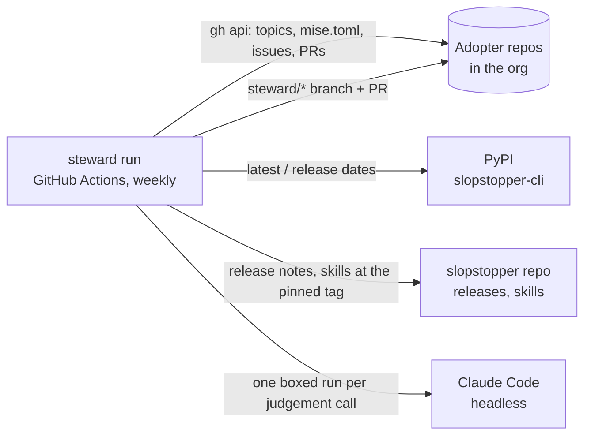
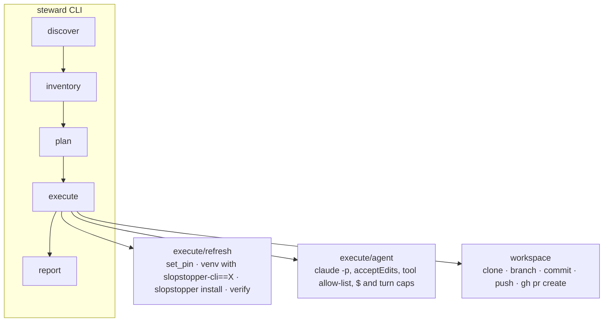

# Architecture

How a steward run works and where it stops. Notation: C4 (Context +
Container).

## Routes

| When you are…                                                          | Do this                                                                                   |
| ---------------------------------------------------------------------- | ----------------------------------------------------------------------------------------- |
| changing what the steward reads from slopstopper, or slopstopper moved a file, marker or flag | Read [CONTRACT.md](CONTRACT.md) for the surface table, the sync test and the upstream change-map row |

## The split with slopstopper

| Concern | slopstopper (`hungovercoders/slopstopper`) | steward (this repo) |
| ------- | ------------------------------------------ | ------------------- |
| What is wrong in a repo | the checks (`slopstopper run`), the PR comments and issues (`slopstopper emit`), the failure tracker | reads the issues |
| How to fix it | the `slopstopper-triage` and `slopstopper-install` skills, shipped into every adopter | hands the agent the repo's own copy |
| What a repo should carry | `slopstopper install` from the pinned CLI | runs it, from the target version |
| Which version to run | the pin in `mise.toml`, moved by `install.sh --cli-version` | decides the target (PyPI + policy) and rewrites the one line |
| Which repos, when, how much | nothing: slopstopper is per-repo | discovery, budgets, the schedule, the report |

A steward run therefore produces exactly what a careful maintainer with
the two skills open would produce, repo after repo, and nothing a single
adopter could not do by hand.

## C4 – Level 1 (System Context)

## C4 – Level 2 (Container)

## One run, step by step

1. **discover** lists every non-archived repo in each org and probes two
   files per repo (`mise.toml`, `.ss/.installed-from`); a repo is an
   adopter only when one of those is present. The `slopstopper` topic is
   recorded as evidence but never sufficient: it needs admin rights to
   set, so most installs never get it, and it survives an uninstall, so a
   topic-only repo must not receive a suite.
2. **inventory** reads the pin, `.slopstopper.yml`'s `profile`, every
   open issue (kept when it carries the `slopstopper` label, a
   `slopstopper:check=` marker, or the failure tracker's title, since
   `emit` opens an unlabelled issue when a repo refuses labels), the
   `ss-*` workflows GitHub has disabled, and the open `steward/*` PRs with
   their order ids. A labelled issue that names no check or workflow (an
   adopter report on the slopstopper repo itself, a hand-written note) is
   reported, never worked: there is nothing to reproduce. The label needs
   triage rights, so it is trusted on its own; a bare body marker is
   anyone's to type, so it counts only on an issue a bot opened, which is
   what `emit` and the failure tracker are. A person's issue never reaches
   the agent's brief on the strength of a marker.
3. **plan** turns each inventory into orders and applies the budgets:

   | Kind | When | Who does the work | Priority |
   | ---- | ---- | ----------------- | -------- |
   | `upgrade` | the pin is behind the policy's target (`upgrade.policy`, `min_age_days`) | code; the agent only if the static checks go red | 0 |
   | `refresh` | the pin is current but `.ss/.installed-from` is older | code; same fallback | 1 |
   | `triage` | an open finding, security first | the agent with the repo's triage skill | 2 / 3 |

   A disabled workflow is reported, not worked: enabling one changes
   repo settings and needs an admin. So is any upgrade or refresh whose
   target has no `slopstopper install` (below `MIN_INSTALL_VERSION`).
4. **execute** clones each order's repo, branches `steward/<order id>`
   and runs the executor. Nothing is pushed until the work is committed;
   the agent cannot push at all. The pin moves through one PR at a time:
   while an upgrade or refresh PR is open, a newer release waits for it
   to merge or close rather than opening a second one beside it.
5. **verify** asks the pinned CLI which checks a clone can run: what
   `checks list --json` says the repo keeps, minus what `profile expand
   library --json` says needs a deployed surface. A check whose tool
   `doctor --json` reports missing on the steward's runner, or one listed
   in `steward/checks.py` as needing an installed environment (each pinned
   by a contract row), is reported in the PR as "not verified by the
   steward" rather than run, since its exit 2 would say nothing about the
   change; the PR's own `ss-*` workflows run it. Any other exit 2 is red.
6. **report** writes `.steward/reports/run.{md,json}` and the Actions job
   summary.
## Where the agent is boxed

The agent edits files, and the steward later runs git, `gh` and the
pinned CLI on those same files with the push token in its own
environment. So the box has three layers, and each assumes the one before
it can fail.

1. **What the agent can do.** It runs inside the clone with
   `--permission-mode acceptEdits`, file edits, and a short allow-list of
   commands that execute nothing from the tree: `slopstopper run` for the
   hygiene and static security checks only (the browser and API checks
   build or serve the repo), the listing commands, `git status`, and the
   shell readers. An explicit deny-list names the ways to run an arbitrary
   command (`find`, `task`, `git grep`, interpreters, shells, `gh`, `curl`,
   `npm`, `pip`), edits under `.git/`, and edits to the run's venvs.
2. **What the agent can see.** Its environment is rebuilt from an
   allow-list (`steward/sandbox.py`): no `GH_TOKEN`, no `GITHUB_TOKEN`, no
   `STEWARD_*`, and a throwaway `HOME`, so there is no stored `gh` login
   and no `~/.gitconfig` to use or plant. `PYTHONSAFEPATH` stops a
   `lizard` module planted in the clone from being imported by `python -m lizard`. The
   one secret it gets is the model key, because it is the model.
3. **What the steward does after it.** `.git/config` is restored from a
   snapshot taken before the agent ran, its hooks are cleared, and every
   steward git command runs with fsmonitor and hooks off and no global or
   system config. That matters beyond the agent: `slopstopper install`
   points `core.hooksPath` at the repo's own `.githooks`, which would
   otherwise run on the steward's push. Verification runs the pinned CLI
   from a venv outside the clone, in the same stripped environment as the
   agent, so even a tampered tree cannot reach the token through it.

What is left: something the agent wrote can still make the steward's own
verification read green (for instance by overwriting the venv's files
through a path the deny rules do not cover). That costs a ready PR
instead of a draft, never the token, and the PR's own `ss-*` workflows
run every check again on GitHub. Treat the steward's verification as
advisory and the PR's CI as the gate.

The rest of the brief:

- The issue body is quoted as data inside the brief, but a brief is still
  text a model reads: the box, not the wording, stops an instruction
  planted in an issue from reaching GitHub.
- `--max-budget-usd` and `--max-turns` come from `budgets.*`. The timeout
  comes from the run: never more than an hour, and never past the push
  token's deadline less ten minutes for verification and the PR.
- Its brief (`steward/prompts.py`) names the work and the skill. The
  method is the skill's; the brief only adds the rules a steward needs
  that a human reader would already know: never edit `ss-*.yml`, never
  move the pin, never disable a check to go green, report a slopstopper
  bug instead of patching around it.
- It must leave `.steward-result.json` (outcome, summary, category,
  what it verified, an upstream report if the fault is slopstopper's).
  A missing or `skipped` result with a clean tree opens nothing; a
  `partial` or still-red result opens a **draft** PR with the failures in
  the body.
- A triage PR says `Closes #N` only when the steward re-ran that
  finding's check green in its own clone. Otherwise it says `Refs #N`
  with a "Not verified by the steward" section, so merging never closes
  an issue on the agent's word alone.

## What never happens

No merge, no push to a default branch, no second PR for an order that has
one open, no edit of an issue, no label on an issue, no repo settings
change. An issue with the `labels.ignore` label (`steward:ignore` by
default) is never picked up.
